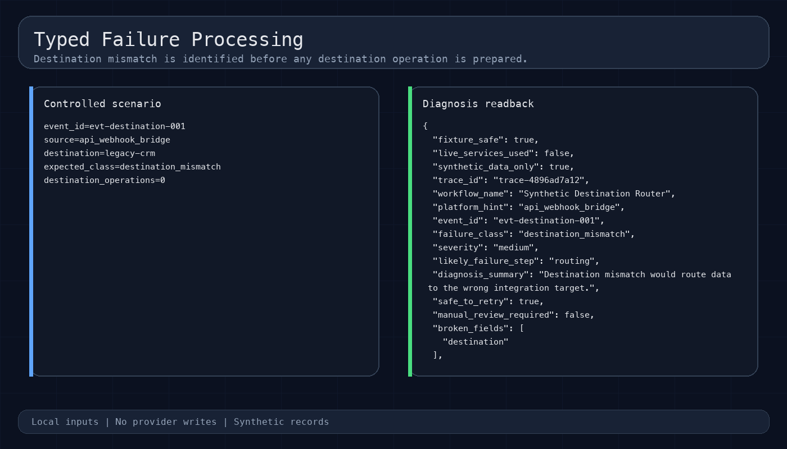

# Automation Debugger

Diagnose failed Zapier, Make, n8n, webhook, and API workflows before a retry creates duplicate or incorrect downstream work.

**Status:** an SM Systems reference tool with deterministic local scenarios and mock destinations.

**My contribution:** failure taxonomy, diagnosis and replay controls, CLI/API implementation and tests.

[Case study](docs/case-study.md) | [Architecture](docs/architecture.md) | [API reference](docs/api.md)



*Generated panel from synthetic local scenarios. Further views are in the [image index](docs/screenshots/README.md); recorded totals are separate from current CI.*

## How it works

Automation Debugger separates diagnosis from replay. It normalizes provider-shaped input, assigns a stable trace ID, classifies the failure, proposes deterministic corrections, and decides whether a local replay is safe.

Duplicate events, invalid signatures, missing required fields, unknown event types, and repeated downstream errors stop with structured operator guidance. Safe corrections run only against the local mock destination.

```text
Provider export or webhook fixture
              |
              v
      Normalize the event
              |
              v
      Classify the failure
              |
              v
       Evaluate replay risk
          /        \
         v          v
   local replay   refusal
          \        /
           v      v
     operating report
```

The source fixture remains unchanged. A corrected payload is evaluated separately, and every replay result includes the trace ID, destination boundary, operation count, and safety fields.

## Usage

Python 3.11 is the reference runtime.

```bash
uv venv --python 3.11 .venv
source .venv/bin/activate
uv pip install -e ".[dev]"
```

Generate a local report:

```bash
PYTHONPATH=src python -m automation_debugger.cli report \
  examples/input/malformed-date.json \
  --format html \
  --output /tmp/automation-debugger-report.html
```

## Validation

The repository includes repeatable fixtures for malformed data, missing fields, duplicate events, destination mismatch, unknown event types, invalid signatures, downstream error loops, and rate limiting.

```bash
python -m pytest -q
python -m ruff check .
python -m mypy src
python scripts/verify_examples.py
```

## Scope and current state

- Synthetic fixtures and local mock destinations only.
- No provider credentials or customer records.
- No live webhook delivery or downstream API calls.
- No production retry execution.
- Live connections require scoped credentials, sanitized samples, durable storage, monitoring, and explicit operator approval.

Every diagnosis and replay response declares:

```text
fixture_safe=true
live_services_used=false
synthetic_data_only=true
```

## Documentation

| Document | Purpose |
| --- | --- |
| [Case study](docs/case-study.md) | Engineering decisions, representative paths, and production extension. |
| [Architecture](docs/architecture.md) | Component boundaries and data flow. |
| [API reference](docs/api.md) | Local endpoints and request contracts. |
| [Local operation](docs/local-operation.md) | Repeatable CLI, API, and report commands. |
| [Validation record](docs/validation.md) | Commands, fixtures, and checked boundaries. |
| [Image index](docs/screenshots/README.md) | Functional image sequence and generation command. |
- [Image index](docs/screenshots/README.md)

MIT. See [LICENSE](LICENSE).
